# BlissUI

**Beautiful by default.**

<p align="center">
  <picture>
    <source media="(prefers-color-scheme: dark)" srcset="docs/images/pages/hero-dark.webp">
    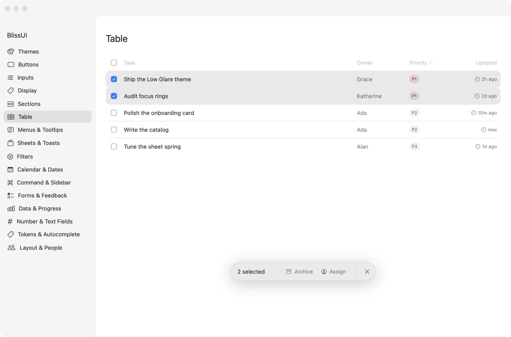
  </picture>
</p>

A SwiftUI component library for macOS — premium components, fluid motion, careful effects, and themes that cover accessibility out of the box. Every piece was built and tuned inside a shipping app before it landed here, so the details are already sweated: focus rings that only show for the keyboard, sheets that hug their content, toasts that stack, traffic lights that stay put through a live resize.

- **Themes** — System, High Contrast, Color Blind Safe and Low Glare built in, plus your own. Light, Dark or System on top of any of them, and a per-theme accent.
- **Tokens** — colors, typography, spacing, sizing and motion, so nothing is hardcoded.
- **Components** — 76 of them: buttons, fields, pickers, calendars, filters, a command palette, sidebars, menus, tooltips, toasts, sheets, tables, progress and data views, forms, avatars and more.
- **Window chrome** — a hidden-title-bar shell with an opaque backdrop, offset traffic lights, drag exclusion for title-bar controls, frame persistence.
- **Accessible** — every control is a Tab stop with one shared ring, VoiceOver labels on icon buttons, Reduce Motion fallbacks, Increase Contrast support.

## Requirements

- macOS 15 or later
- Xcode 26 or later (Swift 6.2 tools)

## Installation

Add the package in Xcode (**File → Add Package Dependencies…**) or in `Package.swift`:

```swift
dependencies: [
    .package(url: "https://github.com/portseif/bliss-ui.git", from: "1.0.0"),
],
targets: [
    .target(name: "MyApp", dependencies: [.product(name: "BlissUI", package: "bliss-ui")]),
]
```

## Quick start

```swift
import SwiftUI
import BlissUI

@main
struct MyApp: App {
    var body: some Scene {
        WindowGroup {
            ContentView()
                .appSheetHost()     // hosts every .appSheet in the window
                .globalToast()      // renders ToastService toasts
                .blissTheme()       // theme, light/dark, accent
                .blissWindowChrome() // opaque shell + traffic lights
                .persistsWindowFrame()
        }
        .windowStyle(.hiddenTitleBar)

        Settings {
            AppearanceSettings()
                .blissTheme()
        }
    }
}
```

```swift
struct ContentView: View {
    @State private var showingSheet = false

    var body: some View {
        VStack(spacing: Spacing.lg) {
            Text("Hello, Bliss")
                .font(Typography.displaySmall)

            HStack(spacing: Spacing.sm) {
                Button("Save") { ToastService.shared.showSuccess(title: "Saved", message: "Your changes are in.") }
                    .buttonStyle(PrimaryButtonStyle())
                Button("Details") { showingSheet = true }
                    .buttonStyle(SecondaryButtonStyle())
            }

            Badge("Live").badgeStyle(.success)
        }
        .padding(Spacing.xl)
        .appSheet(isPresented: $showingSheet) {
            DetailsSheet()
        }
    }
}
```

## Themes

```swift
BlissAppearance.theme = .colorBlindSafe   // or .system, .highContrast, .lowGlare
BlissAppearance.colorScheme = .dark       // .light, .dark, .system
```

| Theme | For |
|---|---|
| **System** | Follows macOS: the built-in palette and your system accent. |
| **High Contrast** | Low vision. Full-strength borders, status colors held to 7:1. |
| **Color Blind Safe** | Okabe & Ito's palette — success, warning, danger and info stay distinct with protan, deutan and tritan vision. |
| **Low Glare** | Light sensitivity and visual stress. Dim, warm surfaces; cream instead of white in light mode. |

<table>
  <tr>
    <td align="center">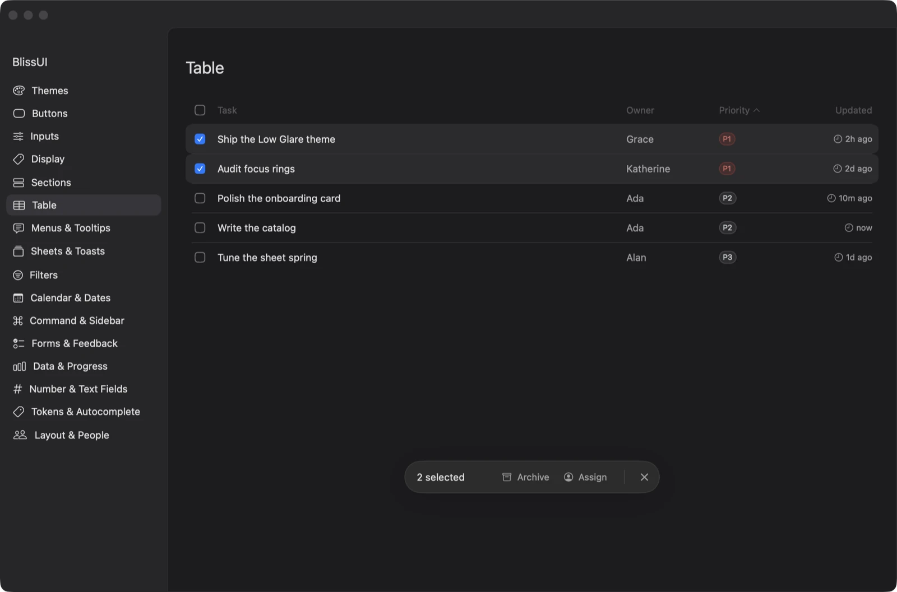<br><sub>System (dark)</sub></td>
    <td align="center">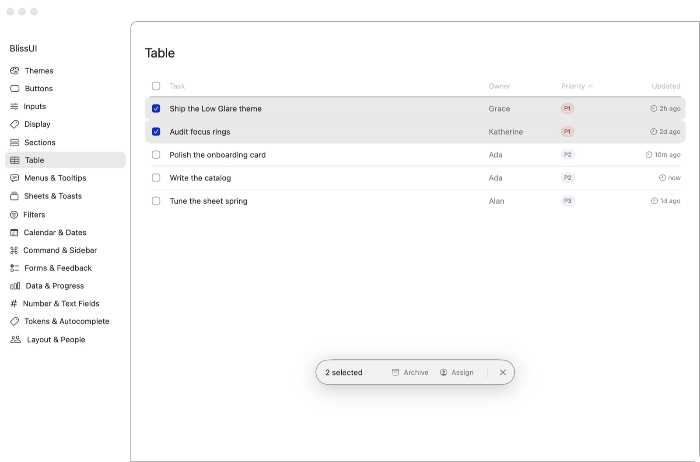<br><sub>High Contrast (light)</sub></td>
  </tr>
  <tr>
    <td align="center">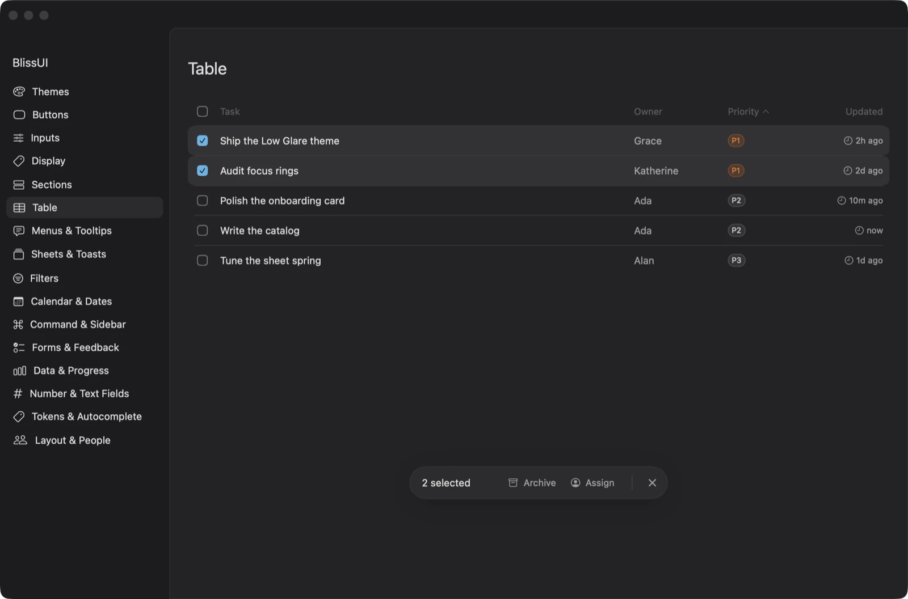<br><sub>Color Blind Safe (dark)</sub></td>
    <td align="center">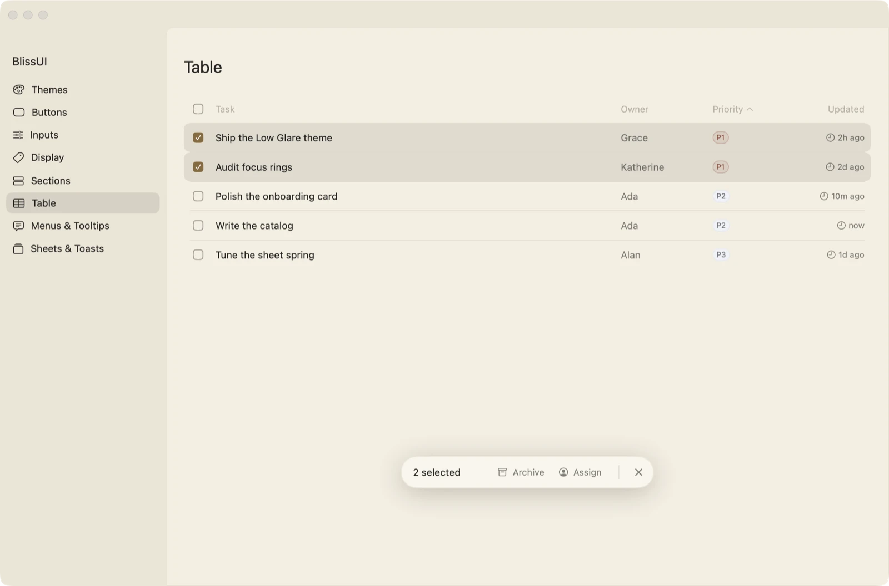<br><sub>Low Glare (light)</sub></td>
  </tr>
</table>

Add your own:

```swift
BlissTheme.register(BlissTheme(
    id: "harbor",
    name: "Harbor",
    light: ThemePalette(
        windowBackground: ThemeRGB(0xEEF2F5), contentBackground: ThemeRGB(0xFFFFFF),
        elevatedBackground: ThemeRGB(0xFFFFFF), border: ThemeRGB(0xD5DDE3), accent: ThemeRGB(0x1F6F8B)
    ),
    dark: ThemePalette(
        windowBackground: ThemeRGB(0x111A20), contentBackground: ThemeRGB(0x16222A),
        elevatedBackground: ThemeRGB(0x1E2D36), border: ThemeRGB(0x2B3D48), accent: ThemeRGB(0x5FB3CE)
    ),
    swatch: [ThemeRGB(0x111A20), ThemeRGB(0x1F6F8B), ThemeRGB(0x5FB3CE), ThemeRGB(0xEEF2F5)]
))
```

Give a palette `status:` colors and BlissUI derives the rest: a mark that clears 4.5:1 (or the theme's `minimumStatusContrast`) on every surface, and a deeper fill that white text reads on.

## Component index

All 79 components, light or dark to match your GitHub theme. Run `swift run BlissCatalog` to try them, and `scripts/screenshots.sh` regenerates these images.

Not pictured, because they're separate panels rather than part of the window: `.tooltip`, the floating menu panel itself, and `InfoHint`'s popover.

<details open>
<summary><b>Buttons & styles</b></summary>

<table>
  <tr>
    <td width="50%" valign="top"><picture><source media="(prefers-color-scheme: dark)" srcset="docs/images/components/buttons-dark.webp">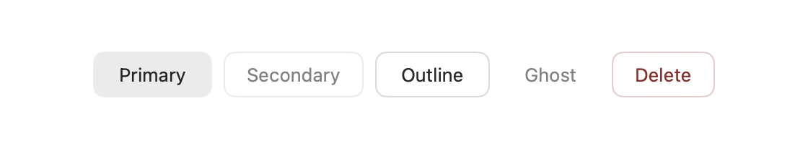</picture><br><b>Buttons</b><br><code>PrimaryButtonStyle</code> · <code>SecondaryButtonStyle</code> · <code>OutlineButtonStyle</code> · <code>GhostButtonStyle</code> · <code>DestructiveButtonStyle</code><br><sub>Linear-style text buttons: hairline borders, neutral hover and press, no accent hue.</sub></td>
    <td width="50%" valign="top"><picture><source media="(prefers-color-scheme: dark)" srcset="docs/images/components/compact-buttons-dark.webp"></picture><br><b>Compact buttons</b><br><code>compact: true</code> on any button style<br><sub>The 28pt sizes every sheet footer uses.</sub></td>
  </tr>
  <tr>
    <td width="50%" valign="top"><picture><source media="(prefers-color-scheme: dark)" srcset="docs/images/components/gradient-button-dark.webp"></picture><br><b>Gradient and pill buttons</b><br><code>AnimatedGradientBorderButtonStyle</code> · <code>SmallPillButtonStyle</code><br><sub>The animated border marks the action that kicks off something big.</sub></td>
    <td width="50%" valign="top"><picture><source media="(prefers-color-scheme: dark)" srcset="docs/images/components/icon-buttons-dark.webp"></picture><br><b>Icon buttons</b><br><code>ToolbarIconButtonStyle</code> · <code>HoverIconButton</code> · <code>InlineIconButtonStyle</code><br><sub>Title-bar icons, hover chips and small inline glyphs.</sub></td>
  </tr>
  <tr>
    <td width="50%" valign="top"><picture><source media="(prefers-color-scheme: dark)" srcset="docs/images/components/text-link-dark.webp"></picture><br><b>Text link</b><br><code>TextLink</code><br><sub>A dotted-underline URL that turns accent on hover.</sub></td>
    <td width="50%" valign="top"><picture><source media="(prefers-color-scheme: dark)" srcset="docs/images/components/loading-buttons-dark.webp"></picture><br><b>Loading buttons</b><br><code>.buttonLoading(_:)</code> on any text button style<br><sub>A spinner takes the label's place at the same size; the button can't be pressed but keeps its enabled look.</sub></td>
  </tr>
</table>

</details>

<details open>
<summary><b>Inputs</b></summary>

<table>
  <tr>
    <td width="50%" valign="top"><picture><source media="(prefers-color-scheme: dark)" srcset="docs/images/components/text-fields-dark.webp">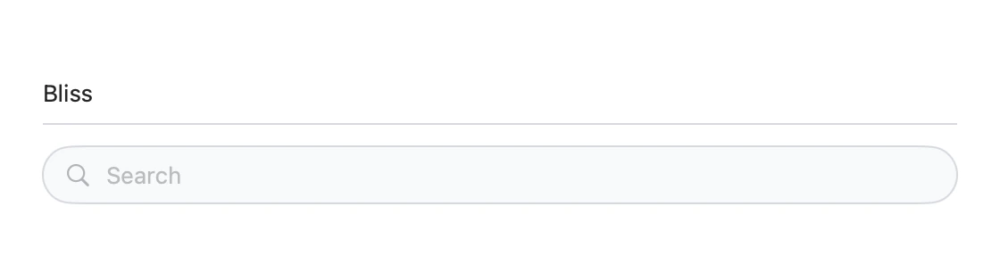</picture><br><b>Text fields</b><br><code>.largePadded</code> · <code>.search</code> · <code>.inputBox(isFocused:)</code><br><sub>An underline that turns accent on focus; the search field gets the shared ring.</sub></td>
    <td width="50%" valign="top"><picture><source media="(prefers-color-scheme: dark)" srcset="docs/images/components/flat-switch-dark.webp"></picture><br><b>Switch</b><br><code>.toggleStyle(.flatSwitch)</code><br><sub>A Tab stop that Space flips, with real switch semantics for VoiceOver.</sub></td>
  </tr>
  <tr>
    <td width="50%" valign="top"><picture><source media="(prefers-color-scheme: dark)" srcset="docs/images/components/checkbox-dark.webp"></picture><br><b>Checkbox</b><br><code>CheckboxGlyph</code><br><sub>The glyph the table and multi-select lists draw.</sub></td>
    <td width="50%" valign="top"><picture><source media="(prefers-color-scheme: dark)" srcset="docs/images/components/segmented-pills-dark.webp">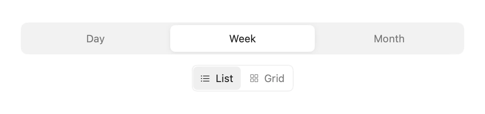</picture><br><b>Segmented pills</b><br><code>SegmentedPills</code><br><sub>A sliding pill; <code>.regular</code> fills its width, <code>.compact</code> hugs its labels.</sub></td>
  </tr>
  <tr>
    <td width="50%" valign="top"><picture><source media="(prefers-color-scheme: dark)" srcset="docs/images/components/floating-menu-picker-dark.webp">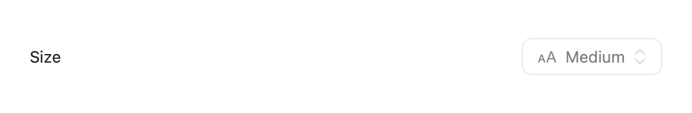</picture><br><b>Dropdown</b><br><code>FloatingMenuPicker</code><br><sub>Opens a floating menu with type-to-filter and keyboard navigation.</sub></td>
    <td width="50%" valign="top"><picture><source media="(prefers-color-scheme: dark)" srcset="docs/images/components/pickers-dark.webp">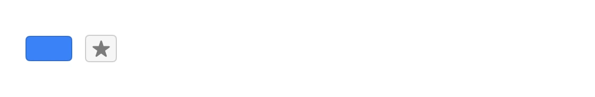</picture><br><b>Color and icon pickers</b><br><code>ColorPickerButton</code> · <code>IconPickerButton</code><br><sub>Swatches plus a custom color; SF Symbols by category, with search.</sub></td>
  </tr>
  <tr>
    <td width="50%" valign="top"><picture><source media="(prefers-color-scheme: dark)" srcset="docs/images/components/browse-input-dark.webp">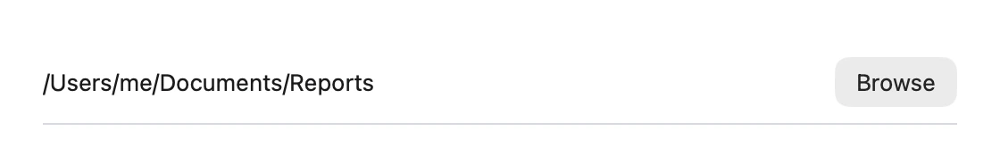</picture><br><b>Browse input</b><br><code>BrowseInput</code><br><sub>A path field with a Browse button that runs an open panel.</sub></td>
    <td width="50%" valign="top"><picture><source media="(prefers-color-scheme: dark)" srcset="docs/images/components/number-field-dark.webp">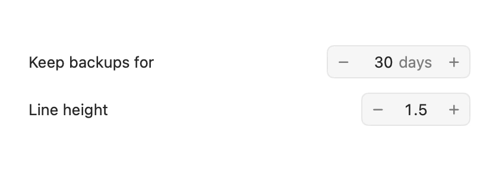</picture><br><b>Number field</b><br><code>NumberField</code><br><sub>− / + steppers, ↑/↓ step (Shift ×10), typing applies as you go and reverts if it isn't a number.</sub></td>
  </tr>
  <tr>
    <td width="50%" valign="top"><picture><source media="(prefers-color-scheme: dark)" srcset="docs/images/components/bliss-slider-dark.webp">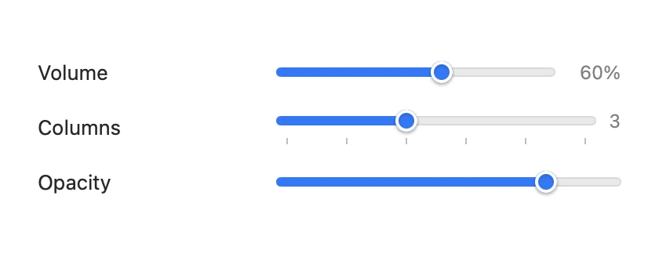</picture><br><b>Slider</b><br><code>BlissSlider</code><br><sub>An accent track with optional ticks and value label; ←/→ step, Home/End jump.</sub></td>
    <td width="50%" valign="top"><picture><source media="(prefers-color-scheme: dark)" srcset="docs/images/components/text-area-dark.webp">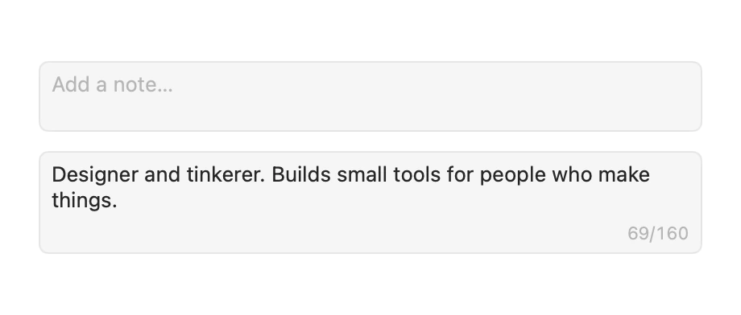</picture><br><b>Text area</b><br><code>TextArea</code><br><sub>Grows with its text between a line range, then scrolls; optional character limit and count.</sub></td>
  </tr>
  <tr>
    <td width="50%" valign="top"><picture><source media="(prefers-color-scheme: dark)" srcset="docs/images/components/token-field-dark.webp">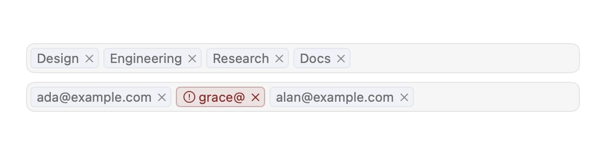</picture><br><b>Token field</b><br><code>TokenField</code><br><sub>Labels or addresses as chips: Return, comma or paste adds, Backspace removes, invalid ones tint red.</sub></td>
    <td width="50%" valign="top"><picture><source media="(prefers-color-scheme: dark)" srcset="docs/images/components/combo-box-dark.webp">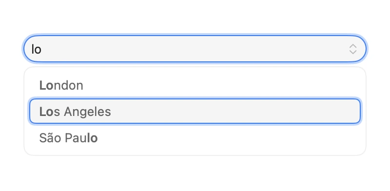</picture><br><b>Combo box</b><br><code>ComboBox</code><br><sub>A field with ranked suggestions under it; free text or restricted to its options.</sub></td>
  </tr>
  <tr>
    <td width="50%" valign="top"><picture><source media="(prefers-color-scheme: dark)" srcset="docs/images/components/shortcut-recorder-dark.webp">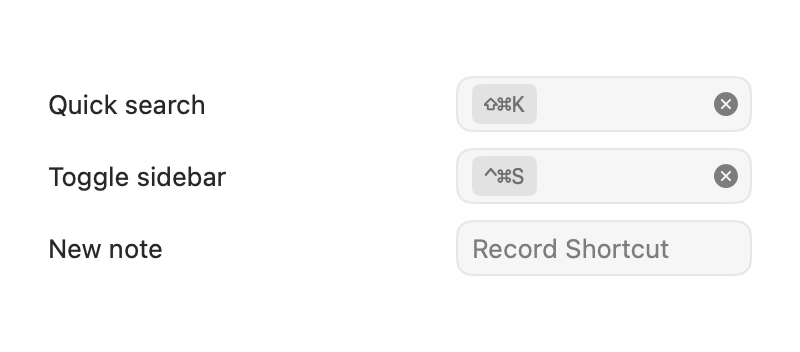</picture><br><b>Shortcut recorder</b><br><code>ShortcutRecorder</code> · <code>KeyboardShortcutValue</code><br><sub>Click and press a combo; Esc cancels, Delete clears.</sub></td>
    <td width="50%" valign="top"><picture><source media="(prefers-color-scheme: dark)" srcset="docs/images/components/secret-field-dark.webp">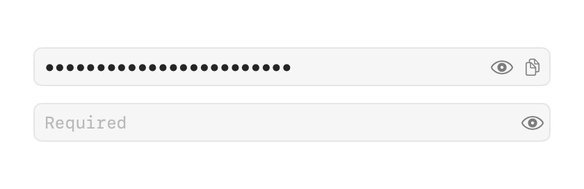</picture><br><b>Secret field</b><br><code>SecretField</code> · <code>RevealToggleIcon</code><br><sub>Masked until revealed, with a copy that's concealed from clipboard managers; the value masks itself again when the app goes to the background.</sub></td>
  </tr>
</table>

</details>

<details open>
<summary><b>Calendar & dates</b></summary>

<table>
  <tr>
    <td width="50%" valign="top"><picture><source media="(prefers-color-scheme: dark)" srcset="docs/images/components/month-calendar-dark.webp">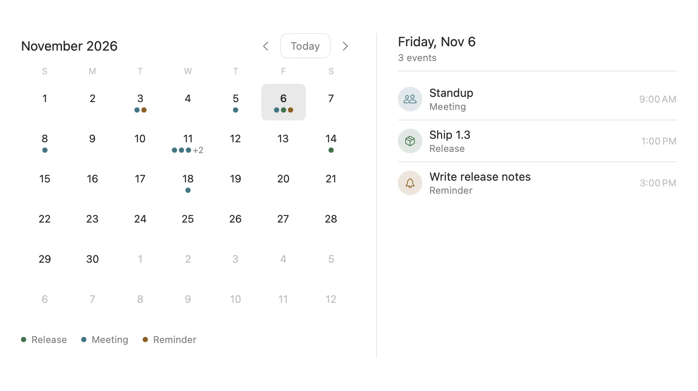</picture><br><b>Month calendar</b><br><code>MonthCalendar</code> · <code>CalendarDayMarker</code><br><sub>Day markers, a legend and a day-detail slot; arrow keys move the day.</sub></td>
    <td width="50%" valign="top"><picture><source media="(prefers-color-scheme: dark)" srcset="docs/images/components/date-picker-field-dark.webp">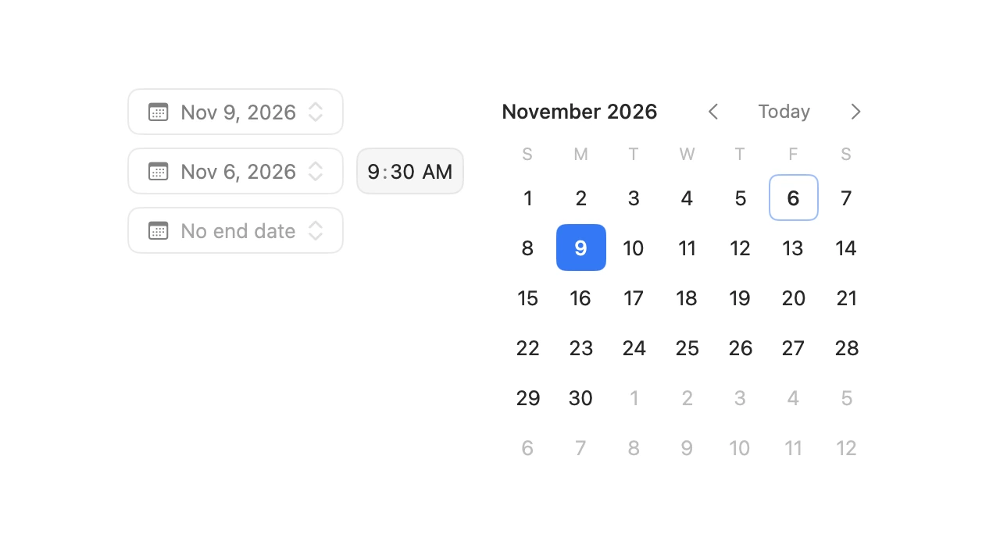</picture><br><b>Date picker</b><br><code>DatePickerField</code><br><sub>A closed field that opens a compact calendar, with optional time and bounds.</sub></td>
  </tr>
  <tr>
    <td width="50%" valign="top"><picture><source media="(prefers-color-scheme: dark)" srcset="docs/images/components/date-range-picker-field-dark.webp">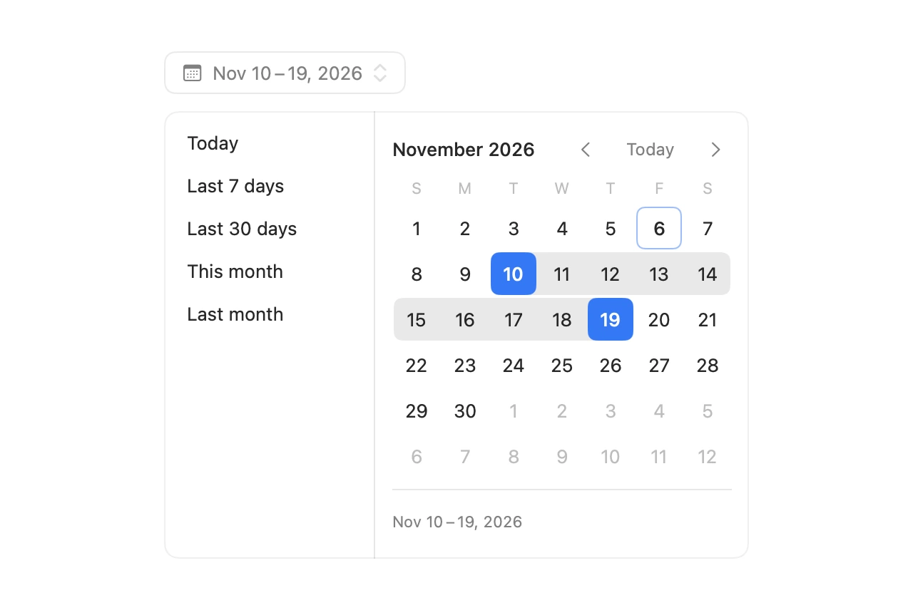</picture><br><b>Date range picker</b><br><code>DateRangePickerField</code> · <code>DateRangePreset</code><br><sub>Start to end on one calendar, with presets like Last 7 days.</sub></td>
    <td width="50%"></td>
  </tr>
</table>

</details>

<details open>
<summary><b>Filters</b></summary>

<table>
  <tr>
    <td width="50%" valign="top"><picture><source media="(prefers-color-scheme: dark)" srcset="docs/images/components/filter-bar-dark.webp">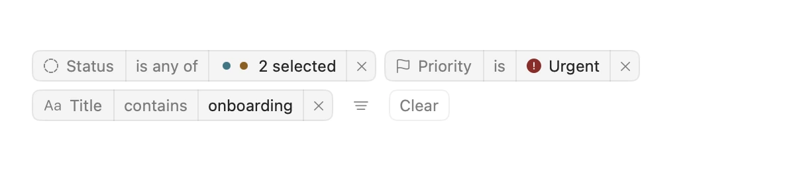</picture><br><b>Filter bar</b><br><code>FilterBar</code> · <code>FilterField</code> · <code>FilterCondition</code><br><sub>Linear-style chips: field │ operator │ values │ ×, with a matcher for your rows.</sub></td>
    <td width="50%" valign="top"><picture><source media="(prefers-color-scheme: dark)" srcset="docs/images/components/filter-menu-button-dark.webp">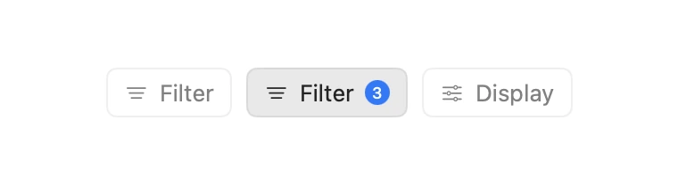</picture><br><b>Filter button</b><br><code>FilterMenuButton</code><br><sub>The Filter / Display trigger with an active-count badge.</sub></td>
  </tr>
  <tr>
    <td width="50%" valign="top"><picture><source media="(prefers-color-scheme: dark)" srcset="docs/images/components/filter-check-rows-dark.webp">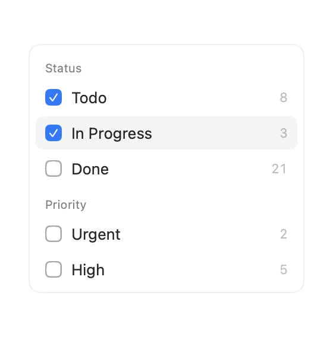</picture><br><b>Filter rows</b><br><code>FilterCheckRow</code> · <code>FilterMenuSectionHeader</code><br><sub>Checkbox facets with counts for a Filter menu that stays open.</sub></td>
    <td width="50%" valign="top"><picture><source media="(prefers-color-scheme: dark)" srcset="docs/images/components/display-radio-rows-dark.webp">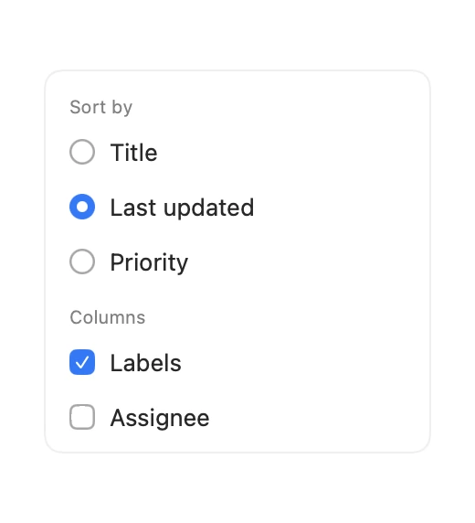</picture><br><b>Display rows</b><br><code>DisplayRadioRow</code><br><sub>Sort and column options; radio and checkbox rows line up.</sub></td>
  </tr>
  <tr>
    <td width="50%" valign="top"><picture><source media="(prefers-color-scheme: dark)" srcset="docs/images/components/filter-menu-rows-dark.webp">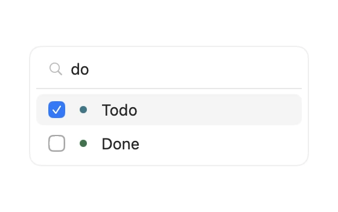</picture><br><b>Searchable menu rows</b><br><code>FilterMenuSearchHeader</code> · <code>FilterMenuRow</code><br><sub>Type to filter a long menu; ↑/↓ and Return pick.</sub></td>
    <td width="50%"></td>
  </tr>
</table>

</details>

<details open>
<summary><b>Display</b></summary>

<table>
  <tr>
    <td width="50%" valign="top"><picture><source media="(prefers-color-scheme: dark)" srcset="docs/images/components/badges-dark.webp">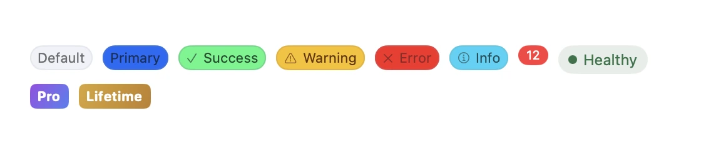</picture><br><b>Badges</b><br><code>Badge</code> · <code>.badgeStyle(_:)</code> · <code>Badge(count:)</code> · <code>Badge.status</code><br><sub>One badge with semantic, count, status, solid and gradient styles.</sub></td>
    <td width="50%" valign="top"><picture><source media="(prefers-color-scheme: dark)" srcset="docs/images/components/status-dot-pill-dark.webp"></picture><br><b>Status pill</b><br><code>StatusDotPill</code><br><sub>A dot and a label, lifted for contrast on dark.</sub></td>
  </tr>
  <tr>
    <td width="50%" valign="top"><picture><source media="(prefers-color-scheme: dark)" srcset="docs/images/components/status-pill-dark.webp">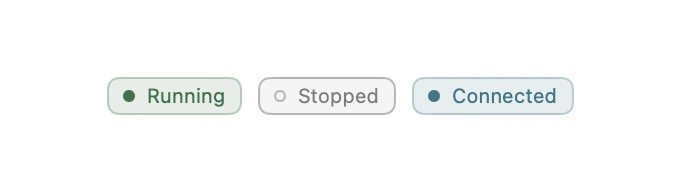</picture><br><b>Status pill (on/off)</b><br><code>StatusPill</code><br><sub>A bordered pill whose off state goes neutral with a hollow ring.</sub></td>
    <td width="50%" valign="top"><picture><source media="(prefers-color-scheme: dark)" srcset="docs/images/components/key-hint-pill-dark.webp">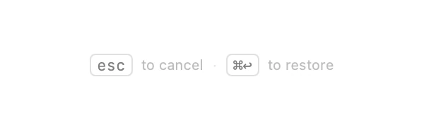</picture><br><b>Key hint</b><br><code>KeyHintPill</code><br><sub>Outlined key caps for footer hints like esc to cancel.</sub></td>
  </tr>
  <tr>
    <td width="50%" valign="top"><picture><source media="(prefers-color-scheme: dark)" srcset="docs/images/components/spinner-shimmer-dark.webp"></picture><br><b>Spinner and shimmer</b><br><code>ThinkingSpinner</code> · <code>ShimmerTextOverlay</code><br><sub>A tintable indeterminate spinner, and a shimmer for "working" text.</sub></td>
    <td width="50%" valign="top"><picture><source media="(prefers-color-scheme: dark)" srcset="docs/images/components/numbers-keys-time-dark.webp"></picture><br><b>Numbers, keys and time</b><br><code>SlidingNumber</code> · <code>ShortcutKey</code> · <code>TimeAgoLabel</code> · <code>InfoButton</code><br><sub>Rolling digits, key caps, relative ages and a click-to-read hint.</sub></td>
  </tr>
  <tr>
    <td width="50%" valign="top"><picture><source media="(prefers-color-scheme: dark)" srcset="docs/images/components/path-hover-chip-dark.webp"></picture><br><b>Path chip</b><br><code>PathHoverChip</code> · <code>PathHoverChip.code</code><br><sub>Morphs into a frosted chip with Copy and Reveal (or Run) on hover.</sub></td>
    <td width="50%" valign="top"><picture><source media="(prefers-color-scheme: dark)" srcset="docs/images/components/terminal-output-dark.webp">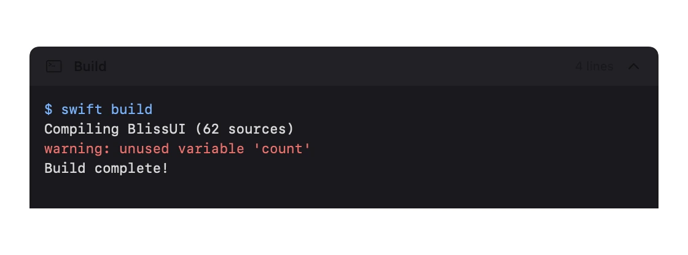</picture><br><b>Terminal output</b><br><code>TerminalOutputView</code><br><sub>Collapsible stdout / stderr / system lines.</sub></td>
  </tr>
  <tr>
    <td width="50%" valign="top"><picture><source media="(prefers-color-scheme: dark)" srcset="docs/images/components/empty-state-dark.webp">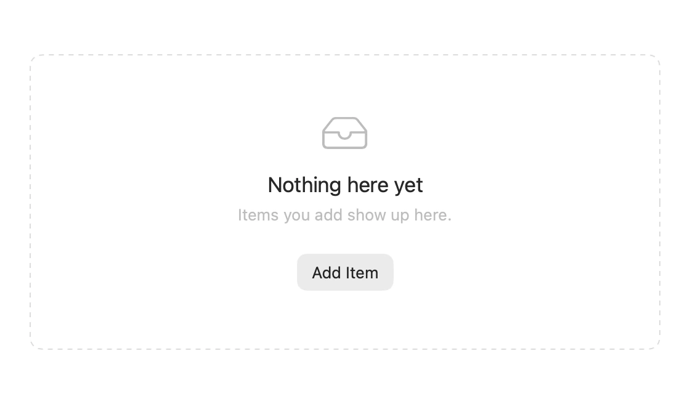</picture><br><b>Empty state</b><br><code>EmptyState</code> · <code>.contained()</code><br><sub>One empty state everywhere; <code>.contained()</code> for a section inside a page.</sub></td>
    <td width="50%"></td>
  </tr>
</table>

</details>

<details open>
<summary><b>Data & progress</b></summary>

<table>
  <tr>
    <td width="50%" valign="top"><picture><source media="(prefers-color-scheme: dark)" srcset="docs/images/components/progress-bar-dark.webp">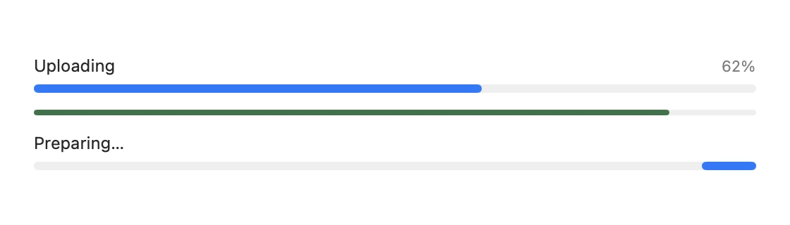</picture><br><b>Progress bar</b><br><code>ProgressBar</code><br><sub>Determinate with an optional label and percent, or an indeterminate sweep.</sub></td>
    <td width="50%" valign="top"><picture><source media="(prefers-color-scheme: dark)" srcset="docs/images/components/progress-ring-dark.webp">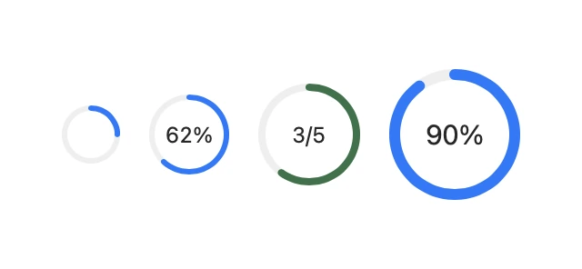</picture><br><b>Progress ring</b><br><code>ProgressRing</code><br><sub>A determinate ring with a percentage or text in the middle.</sub></td>
  </tr>
  <tr>
    <td width="50%" valign="top"><picture><source media="(prefers-color-scheme: dark)" srcset="docs/images/components/usage-bar-dark.webp">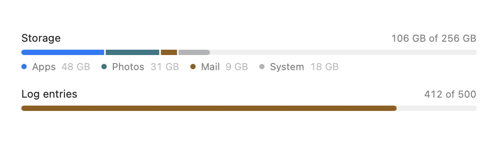</picture><br><b>Usage bar</b><br><code>UsageBar</code><br><sub>Stacked segments with a legend and total, or a meter that turns amber then red.</sub></td>
    <td width="50%" valign="top"><picture><source media="(prefers-color-scheme: dark)" srcset="docs/images/components/tick-strip-dark.webp">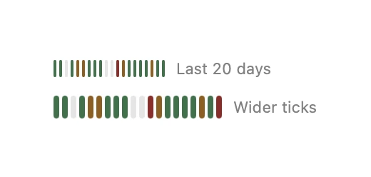</picture><br><b>Tick strip</b><br><code>TickStrip</code><br><sub>One tick per period in its state's color, with a tooltip per tick.</sub></td>
  </tr>
  <tr>
    <td width="50%" valign="top"><picture><source media="(prefers-color-scheme: dark)" srcset="docs/images/components/change-blocks-dark.webp">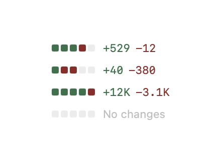</picture><br><b>Change blocks</b><br><code>ChangeBlocks</code><br><sub>Additions and deletions as blocks with compact counts.</sub></td>
    <td width="50%" valign="top"><picture><source media="(prefers-color-scheme: dark)" srcset="docs/images/components/sparkline-dark.webp">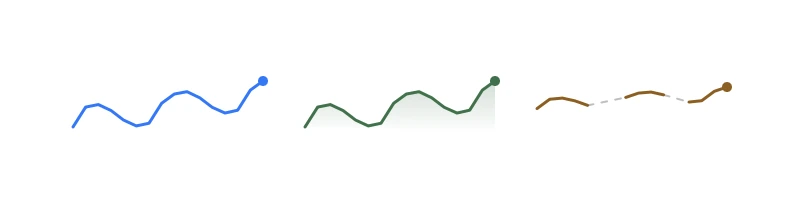</picture><br><b>Sparkline</b><br><code>Sparkline</code><br><sub>A tiny trend line with an optional area wash; gaps draw dashed.</sub></td>
  </tr>
</table>

</details>

<details open>
<summary><b>Sections & forms</b></summary>

<table>
  <tr>
    <td width="50%" valign="top"><picture><source media="(prefers-color-scheme: dark)" srcset="docs/images/components/rounded-section-dark.webp">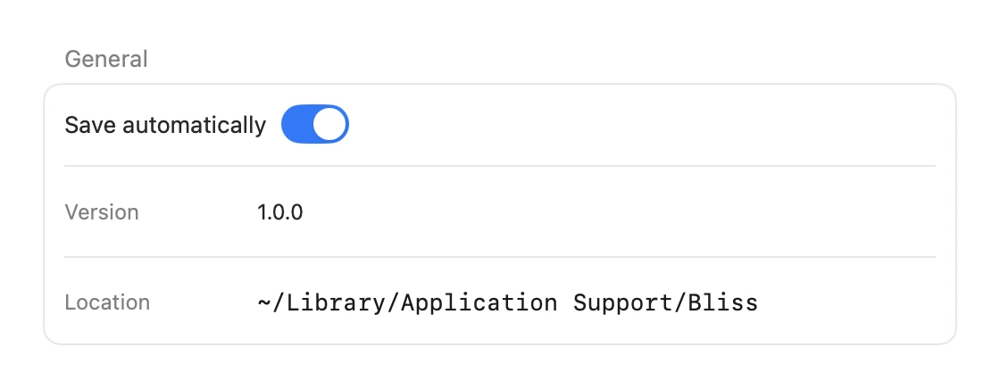</picture><br><b>Rounded section</b><br><code>RoundedSection</code> · <code>SettingsForm</code> · <code>DetailRow</code><br><sub>The settings and form card, with copyable and path rows.</sub></td>
    <td width="50%" valign="top"><picture><source media="(prefers-color-scheme: dark)" srcset="docs/images/components/section-header-dark.webp">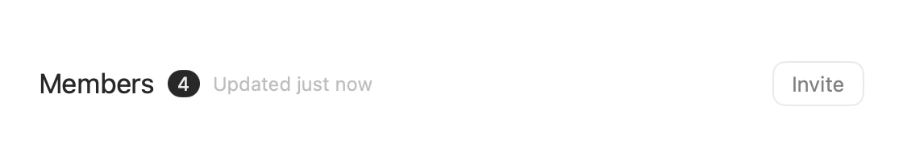</picture><br><b>Section header</b><br><code>SectionHeader</code><br><sub>A heading with a count capsule, a caption and a trailing action.</sub></td>
  </tr>
  <tr>
    <td width="50%" valign="top"><picture><source media="(prefers-color-scheme: dark)" srcset="docs/images/components/info-rows-dark.webp">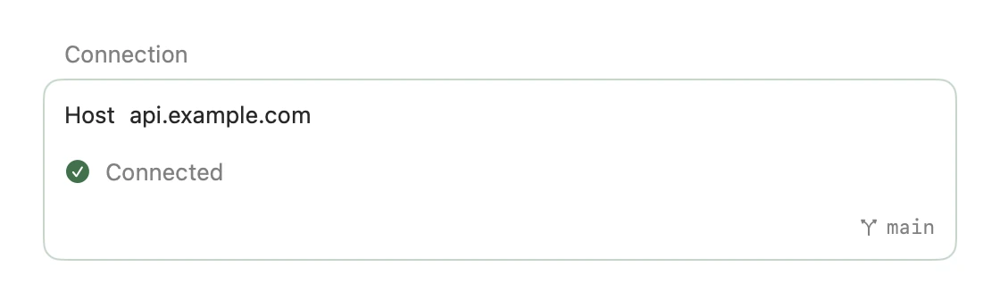</picture><br><b>Info rows</b><br><code>InfoRow.labeled</code> · <code>.status</code> · <code>.branch</code> · <code>.hint</code><br><sub>Prebuilt rows for status cards; a passing check tints the border, never fills it.</sub></td>
    <td width="50%" valign="top"><picture><source media="(prefers-color-scheme: dark)" srcset="docs/images/components/settings-rows-dark.webp">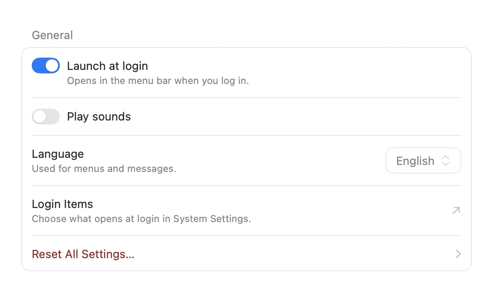</picture><br><b>Settings rows</b><br><code>SettingsRow</code> · <code>SettingsToggleRow</code> · <code>SettingsActionRow</code><br><sub>Title and detail on the left, any control on the right.</sub></td>
  </tr>
  <tr>
    <td width="50%" valign="top"><picture><source media="(prefers-color-scheme: dark)" srcset="docs/images/components/settings-table-of-contents-dark.webp">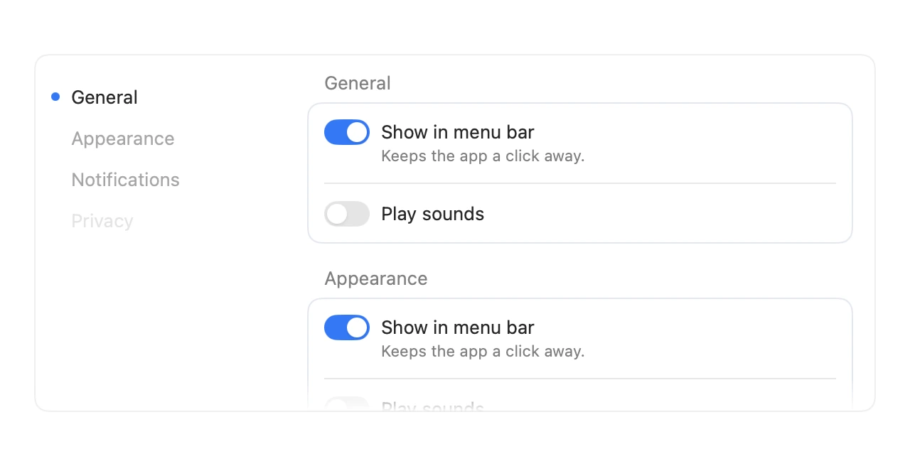</picture><br><b>Settings with contents</b><br><code>SettingsScrollView</code> · <code>.settingsSection(_:)</code><br><sub>A rail that follows the section in view and jumps on click.</sub></td>
    <td width="50%" valign="top"><picture><source media="(prefers-color-scheme: dark)" srcset="docs/images/components/option-cards-dark.webp">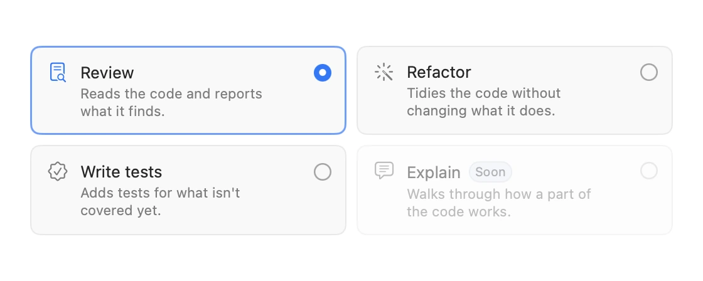</picture><br><b>Option cards</b><br><code>OptionCard</code> · <code>OptionCardGrid</code><br><sub>Pick one, with an icon, detail and optional badge.</sub></td>
  </tr>
  <tr>
    <td width="50%" valign="top"><picture><source media="(prefers-color-scheme: dark)" srcset="docs/images/components/option-cards-plans-dark.webp">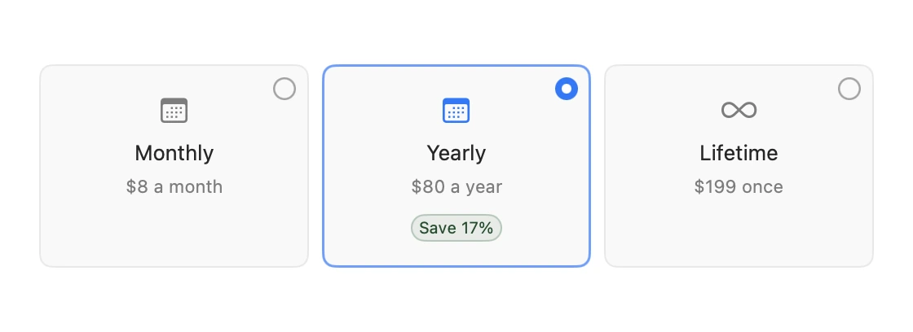</picture><br><b>Plan cards</b><br><code>OptionCardGrid(axis: .vertical)</code><br><sub>Stacked cards of equal height, like a pricing picker.</sub></td>
    <td width="50%" valign="top"><picture><source media="(prefers-color-scheme: dark)" srcset="docs/images/components/option-cards-multiple-dark.webp">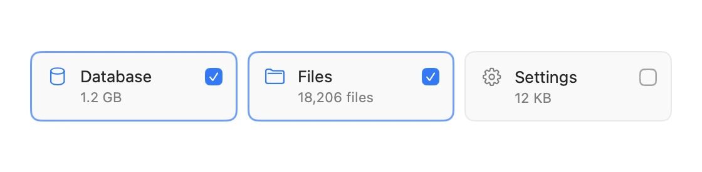</picture><br><b>Multi-select cards</b><br><code>OptionCardGrid(selection: Set)</code><br><sub>Pick many, with checkboxes.</sub></td>
  </tr>
  <tr>
    <td width="50%" valign="top"><picture><source media="(prefers-color-scheme: dark)" srcset="docs/images/components/wizard-radio-rows-dark.webp">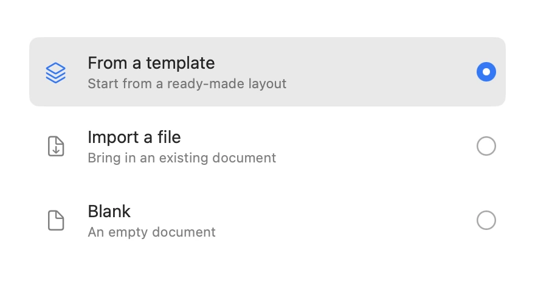</picture><br><b>Wizard choices</b><br><code>WizardRadioRow</code> · <code>RadioGlyph</code><br><sub>Large radio rows for the first step of a flow.</sub></td>
    <td width="50%" valign="top"><picture><source media="(prefers-color-scheme: dark)" srcset="docs/images/components/wizard-step-rows-dark.webp">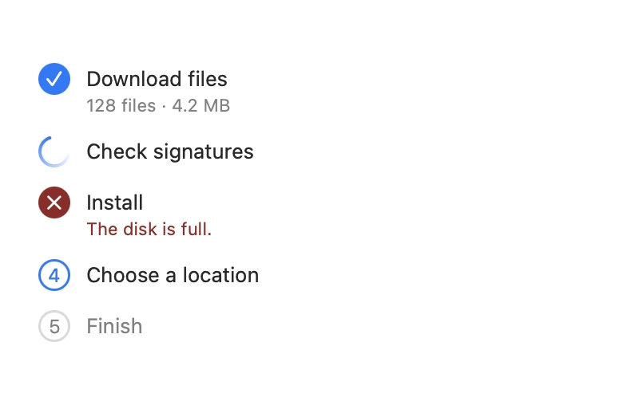</picture><br><b>Wizard steps</b><br><code>WizardStepRow</code><br><sub>Pending, current, running, done and failed, with details.</sub></td>
  </tr>
  <tr>
    <td width="50%" valign="top"><picture><source media="(prefers-color-scheme: dark)" srcset="docs/images/components/form-field-dark.webp">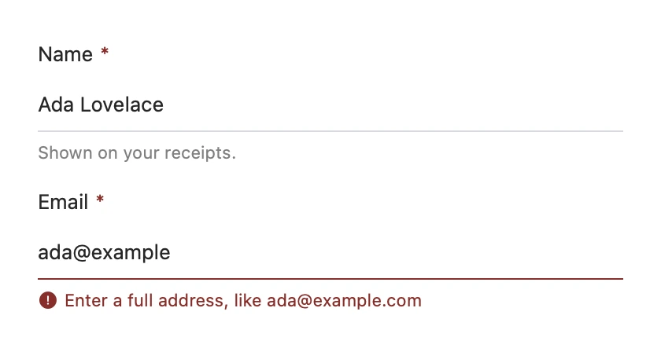</picture><br><b>Form field</b><br><code>FormField</code> · <code>\.formFieldIsInvalid</code><br><sub>A title above the control and a hint or error under it; the error turns the field's line red.</sub></td>
    <td width="50%"></td>
  </tr>
</table>

</details>

<details open>
<summary><b>Feedback</b></summary>

<table>
  <tr>
    <td width="50%" valign="top"><picture><source media="(prefers-color-scheme: dark)" srcset="docs/images/components/banners-dark.webp">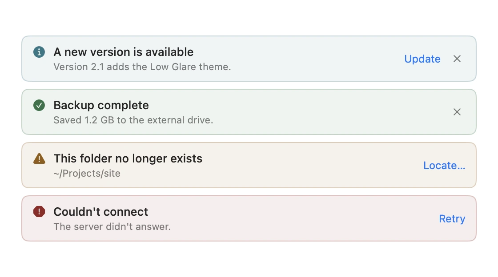</picture><br><b>Banners</b><br><code>Banner</code><br><sub>Inline info, success, warning and danger callouts with an action and dismiss.</sub></td>
    <td width="50%" valign="top"><picture><source media="(prefers-color-scheme: dark)" srcset="docs/images/components/disclosure-section-dark.webp">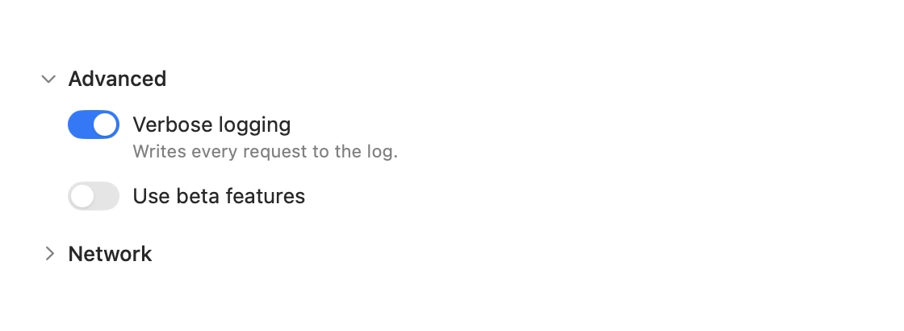</picture><br><b>Disclosure section</b><br><code>DisclosureSection</code><br><sub>An accordion header; Space, Return, → and ← work on it.</sub></td>
  </tr>
  <tr>
    <td width="50%" valign="top"><picture><source media="(prefers-color-scheme: dark)" srcset="docs/images/components/confirmation-sheet-dark.webp"></picture><br><b>Confirmation sheet</b><br><code>.confirmationSheet(isPresented:…)</code><br><sub>An App Sheet for "are you sure": Return confirms, Esc cancels.</sub></td>
    <td width="50%" valign="top"><picture><source media="(prefers-color-scheme: dark)" srcset="docs/images/components/skeleton-dark.webp"></picture><br><b>Skeleton loading</b><br><code>.skeleton(isLoading:)</code> · <code>SkeletonBlock</code><br><sub>Placeholder shapes under one shimmer band; still under Reduce Motion.</sub></td>
  </tr>
</table>

</details>

<details open>
<summary><b>Navigation</b></summary>

<table>
  <tr>
    <td width="50%" valign="top"><picture><source media="(prefers-color-scheme: dark)" srcset="docs/images/components/command-palette-dark.webp"></picture><br><b>Command palette</b><br><code>.commandPalette(isPresented:commands:)</code> · <code>CommandPaletteCommand</code><br><sub>⌘K search with ranked matches, recents and full keyboard control.</sub></td>
    <td width="50%" valign="top"><picture><source media="(prefers-color-scheme: dark)" srcset="docs/images/components/sidebar-dark.webp"></picture><br><b>Sidebar</b><br><code>Sidebar</code> · <code>SidebarRow</code> · <code>SidebarFilterRow</code><br><sub>Destinations with counts, saved filters, ⌘-number hints.</sub></td>
  </tr>
  <tr>
    <td width="50%" valign="top"><picture><source media="(prefers-color-scheme: dark)" srcset="docs/images/components/slideout-panel-dark.webp"></picture><br><b>Slide-out panel</b><br><code>.slideoutPanel(isPresented:title:)</code><br><sub>A panel that slides over the trailing edge; click outside or Esc closes it.</sub></td>
    <td width="50%" valign="top"><picture><source media="(prefers-color-scheme: dark)" srcset="docs/images/components/breadcrumbs-dark.webp"></picture><br><b>Breadcrumbs</b><br><code>Breadcrumbs</code><br><sub>Clickable path segments; the middle folds into a … menu when space runs out.</sub></td>
  </tr>
  <tr>
    <td width="50%" valign="top"><picture><source media="(prefers-color-scheme: dark)" srcset="docs/images/components/underline-tab-bar-dark.webp"></picture><br><b>Underline tabs</b><br><code>UnderlineTabBar</code><br><sub>A sliding underline with optional count chips and icons.</sub></td>
    <td width="50%" valign="top"><picture><source media="(prefers-color-scheme: dark)" srcset="docs/images/components/step-indicator-dark.webp"></picture><br><b>Step indicator</b><br><code>StepIndicator</code><br><sub>Dots for a wizard.</sub></td>
  </tr>
</table>

</details>

<details open>
<summary><b>Tables & lists</b></summary>

<table>
  <tr>
    <td width="50%" valign="top"><picture><source media="(prefers-color-scheme: dark)" srcset="docs/images/components/bliss-table-dark.webp"></picture><br><b>Table</b><br><code>BlissTable</code> · <code>BlissTableColumn</code><br><sub>Sortable columns, checkbox selection with shift-click ranges, row taps.</sub></td>
    <td width="50%" valign="top"><picture><source media="(prefers-color-scheme: dark)" srcset="docs/images/components/selection-bar-dark.webp"></picture><br><b>Selection bar</b><br><code>.selectionBar(count:onClear:)</code> · <code>SelectionBarButton</code><br><sub>The floating bulk-action island; toasts lift to rest above it.</sub></td>
  </tr>
  <tr>
    <td width="50%" valign="top"><picture><source media="(prefers-color-scheme: dark)" srcset="docs/images/components/divided-list-dark.webp"></picture><br><b>Divided list</b><br><code>DividedForEach</code> · <code>.rowHover()</code> · <code>.rowTapAction</code><br><sub>Flat rows with a divider between each pair and one shared hover fill.</sub></td>
    <td width="50%" valign="top"><picture><source media="(prefers-color-scheme: dark)" srcset="docs/images/components/flow-layout-dark.webp"></picture><br><b>Flow layout</b><br><code>FlowLayout</code><br><sub>Wraps chips and tags onto as many lines as they need.</sub></td>
  </tr>
</table>

</details>

<details open>
<summary><b>Layout & people</b></summary>

<table>
  <tr>
    <td width="50%" valign="top"><picture><source media="(prefers-color-scheme: dark)" srcset="docs/images/components/avatars-dark.webp"></picture><br><b>Avatars</b><br><code>Avatar</code><br><sub>Image or initials on a name-hashed color, with presence states.</sub></td>
    <td width="50%" valign="top"><picture><source media="(prefers-color-scheme: dark)" srcset="docs/images/components/avatar-stack-dark.webp"></picture><br><b>Avatar stack</b><br><code>AvatarStack</code><br><sub>Overlapping avatars with +N and a tooltip of names.</sub></td>
  </tr>
  <tr>
    <td width="50%" valign="top"><picture><source media="(prefers-color-scheme: dark)" srcset="docs/images/components/inspector-split-dark.webp"></picture><br><b>Inspector split</b><br><code>InspectorSplit</code><br><sub>A resizable inspector, pinned beside the content or as a drawer.</sub></td>
    <td width="50%" valign="top"><picture><source media="(prefers-color-scheme: dark)" srcset="docs/images/components/code-field-dark.webp"></picture><br><b>Code field</b><br><code>CodeField</code> · <code>CodeHighlighter</code><br><sub>Syntax-highlighted input for shell and YAML, or your own rules.</sub></td>
  </tr>
</table>

</details>

<details open>
<summary><b>Sheets & actions</b></summary>

<table>
  <tr>
    <td width="50%" valign="top"><picture><source media="(prefers-color-scheme: dark)" srcset="docs/images/components/sheet-dark.webp"></picture><br><b>App sheet</b><br><code>.appSheet</code> · <code>AppSheetScaffold</code> · <code>SheetHeader</code><br><sub>Hugs its content, scales from the click point, nests, and is modal for the keyboard too.</sub></td>
    <td width="50%" valign="top"><picture><source media="(prefers-color-scheme: dark)" srcset="docs/images/components/action-bar-dark.webp"></picture><br><b>Action bar</b><br><code>ActionBar</code><br><sub>The footer: side actions lead, Cancel sits directly left of the action.</sub></td>
  </tr>
</table>

</details>

<details open>
<summary><b>Menus, toasts & overlays</b></summary>

<table>
  <tr>
    <td width="50%" valign="top"><picture><source media="(prefers-color-scheme: dark)" srcset="docs/images/components/menu-rows-dark.webp"></picture><br><b>Menu rows</b><br><code>.floatingMenu</code> · <code>PopupMenuService</code> · <code>QuickActionMenuItem</code> · <code>.blissContextMenu</code> · <code>MenuDivider</code><br><sub>Menus open from the trigger's corner, right-click menus at the pointer, and both run from the keyboard. (Drawn inline here; the real one is a panel.)</sub></td>
    <td width="50%" valign="top"><picture><source media="(prefers-color-scheme: dark)" srcset="docs/images/components/toasts-dark.webp"></picture><br><b>Toasts</b><br><code>ToastService</code> · <code>.globalToast()</code><br><sub>Pills that stack into a deck, fan out on hover, and expand errors into a card.</sub></td>
  </tr>
  <tr>
    <td width="50%" valign="top"><picture><source media="(prefers-color-scheme: dark)" srcset="docs/images/components/progress-overlay-dark.webp"></picture><br><b>Progress overlay</b><br><code>ProgressOverlay</code><br><sub>A card for long imports and scans.</sub></td>
    <td width="50%"></td>
  </tr>
</table>

</details>

<details open>
<summary><b>Themes</b></summary>

<table>
  <tr>
    <td width="50%" valign="top"><picture><source media="(prefers-color-scheme: dark)" srcset="docs/images/components/theme-cards-dark.webp"></picture><br><b>Theme cards</b><br><code>ThemeCard</code><br><sub>A swatch per theme, built-in or registered.</sub></td>
    <td width="50%" valign="top"><picture><source media="(prefers-color-scheme: dark)" srcset="docs/images/components/appearance-settings-dark.webp"></picture><br><b>Appearance settings</b><br><code>AppearanceSettings</code><br><sub>The drop-in pane: Light / Dark / System, accent, theme.</sub></td>
  </tr>
</table>

</details>

Run the catalog to see them all (`-page table` opens on a page):

```bash
swift run BlissCatalog
```

## Using this repo as a template

BlissUI is set up as a GitHub template repository. **Use this template → Create a new repository** gives you the package, the test targets (including `BlissUIPublicAPITests`, which compiles only against the public API), CI, and the issue and PR templates. [CLAUDE.md](CLAUDE.md) holds the design-system rules the components follow.

## License

MIT — see [LICENSE](LICENSE).
